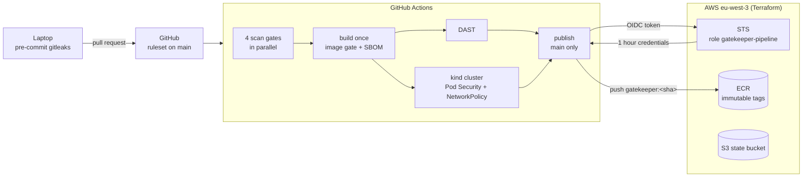

# GATEKEEPER: Secure CI/CD Delivery Chain

[](https://github.com/Ishaan-03/gatekeeper/actions/workflows/gatekeeper.yml)

A secure delivery chain for a small containerised Python API, built with GitHub Actions, Terraform, AWS and Kubernetes. Every change goes through secret scanning, code and dependency scanning, config scanning, an image scan, a DAST scan and a deployment test under Kubernetes Pod Security `restricted` before it can reach Amazon ECR. The push to AWS uses OIDC, so **no AWS key is stored anywhere**. Everything here runs for real on every pull request, and every number below comes from a real scan or run. When something did not work the first time, I kept the story of how I found and fixed it.

| | Before | After |
|---|---|---|
| Container image size | 1.11 GB | 125 MB |
| HIGH + CRITICAL CVEs in the image | 344 (19 CRITICAL) | 0 with a fix available, 0 CRITICAL |
| HIGH CVEs in Python dependencies | 3 | 0 |
| Semgrep findings in my code | 5 | 0 |
| Checkov failed checks | 6 | 0 (1 fixed, 5 skipped with a written reason) |
| ZAP alerts (Medium / Low) | 1 / 3 | 0 / 0 |
| AWS keys stored in CI | | 0 |

**See it run:** PROOF_LINKS_PLACEHOLDER

## What is GATEKEEPER?

The app is deliberately small: a Flask API with `/health` and `/ping`, which checks whether a public IP address answers on port 443. The first version had two planted flaws, command injection and a debug server, so the scanners had something real to find. The app is the thing being delivered. The chain around it is the project.

It answers one question:

> Can a risky change reach production, and could a stolen secret let someone push to it?

| Risk | What stops it |
|---|---|
| A credential is committed | gitleaks, before every commit and over the full history in CI |
| My code is written dangerously | Semgrep |
| A borrowed package has a known CVE | Trivy on the dependencies, then on the built image |
| A config is unsafe | Checkov on Terraform, the Dockerfile, Kubernetes manifests and the workflow |
| The running app is missing protections | A smoke test and an OWASP ZAP baseline scan |
| The workload is too privileged, or too reachable | Pod Security `restricted` and NetworkPolicy, tested in a kind cluster |
| The pipeline itself is attacked | Pinned actions, checksum-verified tools, least-privilege tokens, a ruleset on `main` |
| A stored cloud key leaks | There is none: OIDC to a role that trusts one repository and one branch |

## How it all fits together



## The pipeline

| Job | Tool | Fails the build when |
|---|---|---|
| `secrets` | gitleaks | Any credential anywhere in git history |
| `sast` | Semgrep (`p/python`, `p/flask`) | Any finding |
| `iac` | Checkov | A failed check without a written skip, or no checks ran on the workflow file |
| `sca` | Trivy fs | HIGH or CRITICAL with a fix available |
| `build-scan` | Trivy image + CycloneDX SBOM | HIGH or CRITICAL with a fix available |
| `dast` | curl smoke test + ZAP baseline | A smoke check fails, or any ZAP alert not accepted with a reason |
| `kubernetes` | kind + kubectl | A bad pod is accepted, the deployment is not ready, or the NetworkPolicy does not block and allow as designed |
| `publish` | OIDC + ECR | Runs only on `main`, after all of the above |

The image is built once, saved as a file, and that exact file is what gets attacked, deployed and pushed. It is tagged with the commit SHA, so every image in ECR maps to one commit.

## The build, step by step

```mermaid
flowchart TD
    A["Step 1<br/>Flask API with two planted flaws"] --> B["Step 2<br/>Committed a fake key, deleted it,<br/>gitleaks still found it. Added a pre-commit hook."]
    B --> C["Step 3<br/>Trivy: 3 HIGH CVEs in Flask and Werkzeug.<br/>Upgraded, 0."]
    C --> D["Step 4<br/>Semgrep: 5 findings on the 2 flaws.<br/>Fixed, 0."]
    D --> E["Step 5<br/>Bad image vs hardened image<br/>1.11 GB to 125 MB, 344 to 46 HIGH+CRITICAL"]
    E --> F["Step 6<br/>Terraform: state bucket, ECR,<br/>OIDC role. Found an existing OIDC provider."]
    F --> G["Step 7<br/>Checkov: 6 findings. 1 fixed, 5 skipped with reasons."]
    G --> H["Step 8<br/>Pipeline with every gate wired in"]
    H --> I["Step 9<br/>ZAP: missing security headers. Fixed in the app."]
    I --> J["Step 10<br/>Pinned base image aged: 4 new fixable CVEs.<br/>Refreshed, Dependabot added."]
    J --> K["Step 11<br/>kind job: Pod Security rejects a bad pod,<br/>NetworkPolicy blocks and allows"]
    K --> L["Step 12<br/>Smoke test: /ping broken in the hardened image.<br/>Replaced with a TCP check."]
    L --> M["Step 13<br/>First publish refused: OIDC sub format.<br/>Fixed the trust policy."]
    M --> N["Step 14<br/>A pull request that brings back shell=True<br/>is blocked"]
```



Each part has its own write up:

| Write up | What it covers |
|---|---|
| [Code and container](docs/code-and-container.md) | Secrets in git history, dependency and code scanning, the hardened image, the SBOM |
| [Infrastructure](docs/infrastructure.md) | Terraform state, ECR, the OIDC role, Checkov fixes and skips |
| [Pipeline](docs/pipeline.md) | Every job, DAST, hardening the pipeline itself, what broke and how I found it |
| [Kubernetes](docs/kubernetes.md) | Pod Security `restricted`, the hardened deployment, NetworkPolicy tests, IRSA |
| [Threat model](docs/threat-model.md) | Assets, threats and the control in this repo for each one |
| [Decision log](docs/decision-log.md) | What I chose, what I could have chosen instead, and what it costs |
| [Costs and cleanup](docs/costs-and-cleanup.md) | Where money could go, and how to tear it all down |
| [GitLab CI and Jenkins](docs/ports/README.md) | The same pipeline translated, with a concept table |

## Findings worth keeping

**Deleting a secret does not remove it.** In a throwaway repository I committed a fake API key, deleted it in the next commit, and ran gitleaks: 2 commits scanned, 1 leak found, in the first commit. It was also inside an image layer. The fix for a real leak is revoking the key, which is why the gitleaks gate exists before commits and in CI.

**A pinned base image ages.** Pinning by digest stops anyone swapping the image, and also freezes it. Two weeks after pinning, the same image had 4 HIGH findings with fixes available (`openssl`, `pcre2`). The gate caught them, I moved the pin, and Dependabot now proposes that refresh every week.

**The scanner skipped my workflow file without a word.** A `concurrency` value written as an expression is valid for GitHub, but made Checkov scan 0 resources in the file and still report success. Without it, the same file ran 204 checks. The `iac` job now fails if no checks run on the workflow.

**Hardening broke a feature, and the smoke test caught it.** `/ping` returned 500 for every host in the hardened image: there is no `ping` program, and the pod drops `NET_RAW`. I replaced the subprocess with a TCP check that only accepts public addresses, which also removes the command injection surface entirely and refuses the cloud metadata address.

**GitHub's OIDC subject had numeric IDs in it.** The first publish was refused with `Not authorized to perform sts:AssumeRoleWithWebIdentity`. A diagnostic step printed the real claim, `repo:Ishaan-03@166810647/gatekeeper@1414191999:ref:refs/heads/main`, and the trust policy now matches it. IDs are never reused, so a recreated repository with the same name cannot assume the role.

**The AWS account already had a GitHub OIDC provider.** Only one can exist per account. `terraform plan` could not know, and `apply` would have failed halfway. I looked it up with a `data` source instead, so this project uses it without owning it.

## What is in this repo

| Path | What it holds |
|---|---|
| `app/` | The Flask API and its pinned dependencies |
| `Dockerfile`, `.dockerignore` | The hardened multi-stage image |
| `.github/workflows/gatekeeper.yml` | The pipeline |
| `.github/dependabot.yml` | Weekly updates for actions, Python packages and the base image |
| `.zap/rules.tsv` | ZAP alerts accepted on purpose, each with a reason |
| `.pre-commit-config.yaml` | gitleaks before every commit |
| `infra/bootstrap/` | The S3 state bucket (local state, run once) |
| `infra/main/` | ECR, the OIDC trust and the pipeline role (state in S3) |
| `k8s/` | Namespace, deployment, service, NetworkPolicies, and a pod that must be rejected |
| `docs/` | One write up per part, the threat model, the decision log, and the GitLab and Jenkins ports |
| `evidence/` | Screenshots of real output |

## Running it yourself

```bash
# Locally
pre-commit install
docker build -t gatekeeper:local .
docker run --rm -p 8080:8080 gatekeeper:local
curl -s localhost:8080/health

# Kubernetes (kind v0.24 or newer enforces NetworkPolicy)
kind create cluster --name gatekeeper
kind load docker-image gatekeeper:local --name gatekeeper
kubectl apply -f k8s/
kubectl -n gatekeeper rollout status deployment/gatekeeper

# AWS (eu-west-3)
cd infra/bootstrap && terraform init && terraform apply
cd ../main && terraform init && terraform apply
```

The account ID, bucket name, role ARN and the GitHub IDs in the trust policy are mine. Swap them for your own: the GitHub IDs come from `https://api.github.com/repos/<owner>/<repo>` (`owner.id` and `id`). If your account already has a GitHub OIDC provider, keep the `data` lookup in `infra/main/iam.tf`; if not, create one first.
