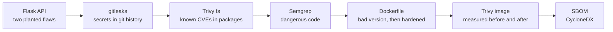
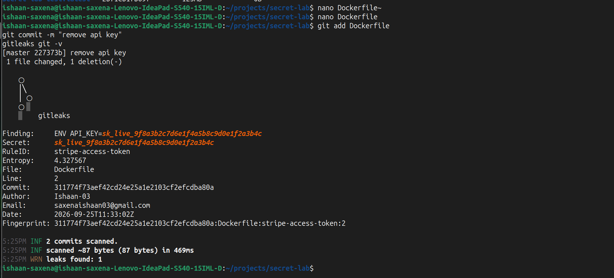
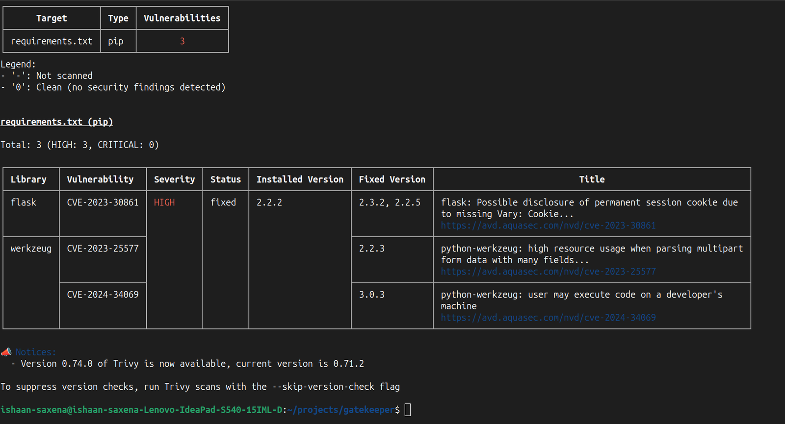
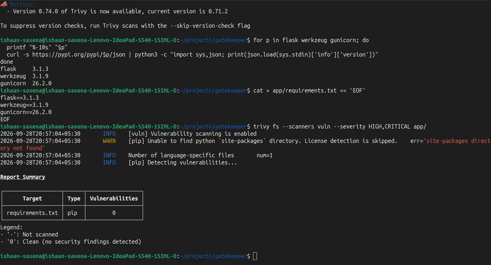
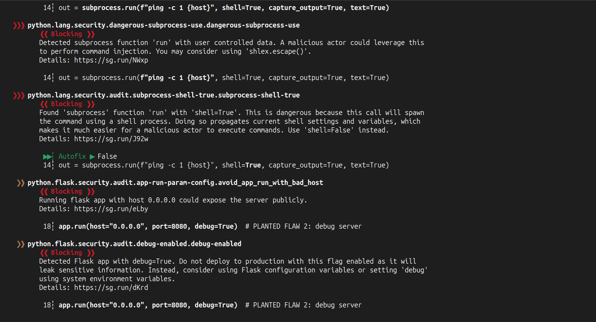
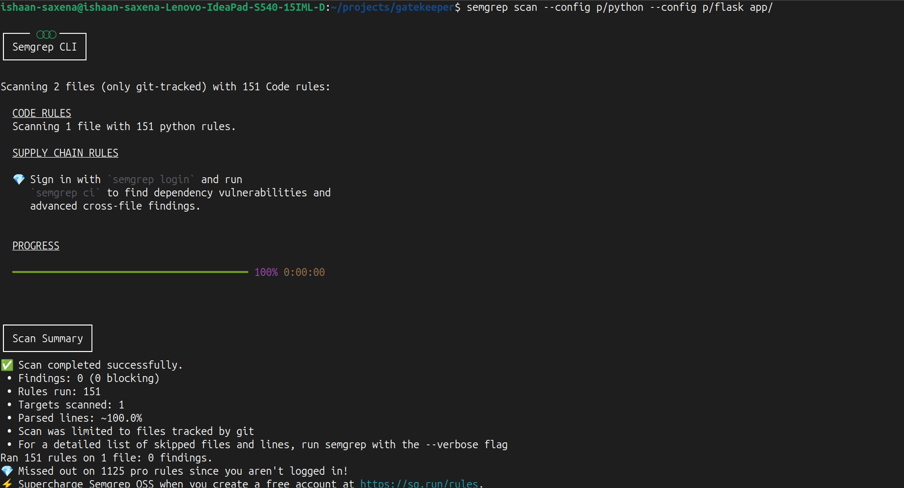

# Code and container

This part covers everything that happens to the code before it leaves my laptop: secrets, borrowed packages, my own code, the image it ships in, and the list of what is inside that image.

## The app

A small Flask API with two endpoints:

| Endpoint | What it does |
|---|---|
| `GET /health` | Returns `{"status": "ok"}` for health checks |
| `GET /ping?host=<ip>` | Checks whether a public IP address answers on port 443 |

The first version was written with two flaws on purpose, so the scanners had something real to find:

1. `/ping` built a shell command from user input: `subprocess.run(f"ping -c 1 {host}", shell=True)`. Sending `8.8.8.8; cat /etc/passwd` would run the second command too. This is command injection.
2. The app started Flask's development server with `debug=True`. Its interactive debugger can run Python code for whoever reaches it.

## Secrets: deleting a line does not delete a leak

Before writing any real code, I tested what actually happens when a secret lands in git. In a throwaway repository that was never pushed anywhere, I committed a Dockerfile with a fake payment API key in an `ENV` line, then ran gitleaks over the history. It found the key and named the rule (`stripe-access-token`) and the commit.

Then I deleted the line and committed again. gitleaks scanned 2 commits and still found 1 leak, in the first commit:

`docker history --no-trunc` on the image built from the first commit also showed the key inside an image layer. Two places keep it forever: git history and image layers.

The lesson I took from this: the real fix for a leaked secret is to revoke and rotate it at the provider. Rewriting history is cleanup, and does nothing for anyone who already cloned the repo.

**Prevention.** The real repo has a `pre-commit` hook that runs gitleaks before every commit (`.pre-commit-config.yaml`, gitleaks pinned to `v8.21.2`). I tested it twice:

* A commit with the example access key from AWS's own documentation **passed**. gitleaks deliberately ignores that well known placeholder, because it appears in thousands of tutorials.
* A commit with a realistic looking payment key was **blocked** with `Failed`, exit code 1, and the secret printed as `REDACTED`. The commit never existed.

The same scan runs again in the pipeline over the full history, because a laptop hook can be skipped.

## Dependencies (SCA)

The first `requirements.txt` pinned `flask==2.2.2` and `werkzeug==2.2.2`. Trivy found 3 HIGH CVEs, all with fixes available:

| Package | CVE | Problem | Fixed in |
|---|---|---|---|
| flask 2.2.2 | CVE-2023-30861 | A session cookie can be cached and served to another user | 2.2.5 / 2.3.2 |
| werkzeug 2.2.2 | CVE-2023-25577 | A form with very many fields can exhaust memory | 2.2.3 |
| werkzeug 2.2.2 | CVE-2024-34069 | The debugger can be tricked into running code on a developer machine | 3.0.3 |

I looked up the latest releases on PyPI and pinned `flask==3.1.3`, `werkzeug==3.1.9` and `gunicorn==26.2.0`. Flask and Werkzeug have to move together, because Flask is built on Werkzeug. The re-scan came back with 0:

`CVE-2024-34069` and the `debug=True` flaw are linked: the vulnerable debugger only runs when debug mode is on. But they come from different places. One is in borrowed code, so Trivy finds it. The other is in my code, so only Semgrep can find it.

## My own code (SAST)

Semgrep with the `p/python` and `p/flask` rulesets reported **5 findings on 2 lines**:

| Line | Rules that fired | Real problem |
|---|---|---|
| `subprocess.run(... shell=True)` | `subprocess-injection`, `dangerous-subprocess-use`, `subprocess-shell-true` | Command injection |
| `app.run(... debug=True)` | `debug-enabled`, `avoid_app_run_with_bad_host` | Debug server |

Three rules describing one bug from different angles is normal. Fixing the line clears all three.

The fix:

* Check that `host` is a real IP address with Python's `ipaddress` module, and return `400` if it is not. That is an allowlist: accept only what looks right.
* Call the command as a list (`["ping", "-c", "1", host]`) with no shell, so a semicolon is just a character.
* Delete the `app.run(...)` block. gunicorn imports the `app` object directly, so the debug server is never started.

Later the pipeline showed that `/ping` still did not work inside the hardened image, for a different reason. The final version uses no subprocess at all. That story is in [Pipeline](pipeline.md).

## The image: bad first, then hardened

I built a deliberately sloppy image first, so the hardened one had a real number to beat.

**The bad Dockerfile:** full `python` base image, `COPY . /app` with no filtering, no `USER` line (so root), and the Flask dev server as the start command.

It did not even build on `python:3.9`. `pip` could not find `gunicorn==26.2.0`, because gunicorn 24 and newer need Python 3.10 or higher. The base image's Python version and the pinned packages have to agree. On `python:3.10` it built.

**The hardened Dockerfile:**

| Change | What it stops |
|---|---|
| `python:3.13-slim` instead of the full image | Hundreds of unused OS packages (compilers, ImageMagick, database clients), each one a source of CVEs and a tool for an attacker |
| Base image pinned by `@sha256:` digest | Someone re-pointing the tag to a different image |
| Multi-stage build | pip's build leftovers stay in the first stage; only installed packages are copied over |
| `USER 10001` (a number, not a name) | An attacker who breaks into the app is not root. Kubernetes `runAsNonRoot` can only verify a numeric user. |
| Copy only `app/main.py`, plus a `.dockerignore` | `.git`, configs and infrastructure code never end up in the image |
| `pip` uninstalled in the final stage | Removes two Python CVEs that lived inside pip's own vendored packages, and an attacker cannot `pip install` tools |
| gunicorn with `--worker-tmp-dir /tmp` | Production server instead of the dev server, and ready for a read-only root filesystem |

**The numbers** (Trivy, HIGH and CRITICAL only):

| | Bad image | Hardened image |
|---|---|---|
| Base | `python:3.10` (full) | `python:3.13-slim`, pinned |
| Size | 1.11 GB | 125 MB (89% smaller) |
| HIGH + CRITICAL | 344 (325 HIGH, 19 CRITICAL) | 46 HIGH, 0 CRITICAL |
| Runs as | root | UID 10001 |

The 46 left on the hardened image were Debian packages with no fix published yet. Most were the same 4 `util-linux` mount bugs counted once per package that includes the library. They need someone running mount commands inside the container, which this app never does.

The pipeline gate blocks HIGH or CRITICAL findings **that have a fix**, because those are the ones I can act on. Two weeks later, that gate caught 4 new fixable ones in the same pinned image. See [Pipeline](pipeline.md).

## SBOM

Every build writes a CycloneDX SBOM with Trivy: a full list of every package in the image, with versions. The first one I made was about 196 KB for a 125 MB image.

Scanning the SBOM file instead of the image gave the same 44 Debian HIGH findings as the image scan. So the file is a faithful stand-in: when a new CVE is published, I can check this small file without rebuilding or downloading the image.

The pipeline uploads the SBOM of every build as an artifact called `sbom`, kept for 30 days.
