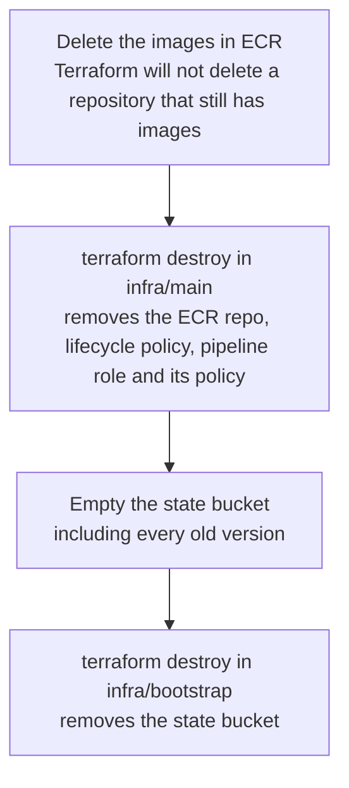

# Costs and cleanup

The whole chain was built to cost close to nothing. I set up a billing alert before building anything, so any real charge sends me an email.

## Where the money goes

| Part | What you pay for | How I kept it small |
|---|---|---|
| GitHub Actions | Runner minutes | Free for public repositories |
| S3 state bucket | Storage and requests | A few KB of state. Old versions expire after 90 days. |
| ECR | Image storage | Images share layers, and the lifecycle policy keeps only the last 5 |
| ECR scan on push | Basic scanning | No charge |
| IAM, STS, OIDC | Nothing | No charge |
| Kubernetes | The cluster | kind runs inside the pipeline runner and is deleted with it. EKS was avoided because its control plane bills by the hour even when idle. |

The pipeline runs Trivy, ZAP and kind on GitHub's machines, not in AWS, so scanning and testing add nothing to the AWS bill.

## Tearing it down

The order matters, because each part depends on the one before it.



```bash
# 1. Delete every image in the repository
aws ecr list-images --repository-name gatekeeper --region eu-west-3 \
  --query 'imageIds[*]' --output json > /tmp/ids.json
aws ecr batch-delete-image --repository-name gatekeeper --region eu-west-3 \
  --image-ids file:///tmp/ids.json

# 2. Destroy the main stack (its state lives in the bucket, so this goes first)
cd infra/main && terraform destroy

# 3. Empty the versioned state bucket in the S3 console ("Empty" deletes all versions)

# 4. Destroy the bucket itself (local state)
cd ../bootstrap && terraform destroy
```

The GitHub OIDC provider is not deleted, because this project only looks it up. Another project created it and may still use it.
