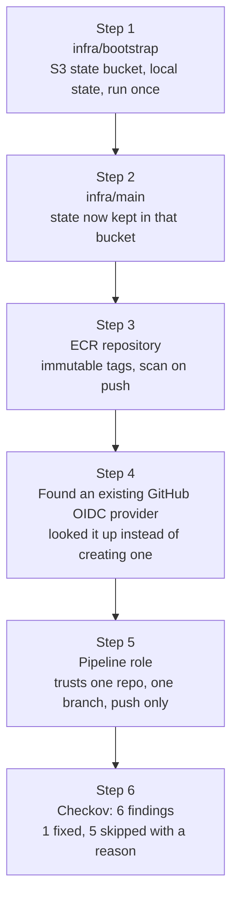
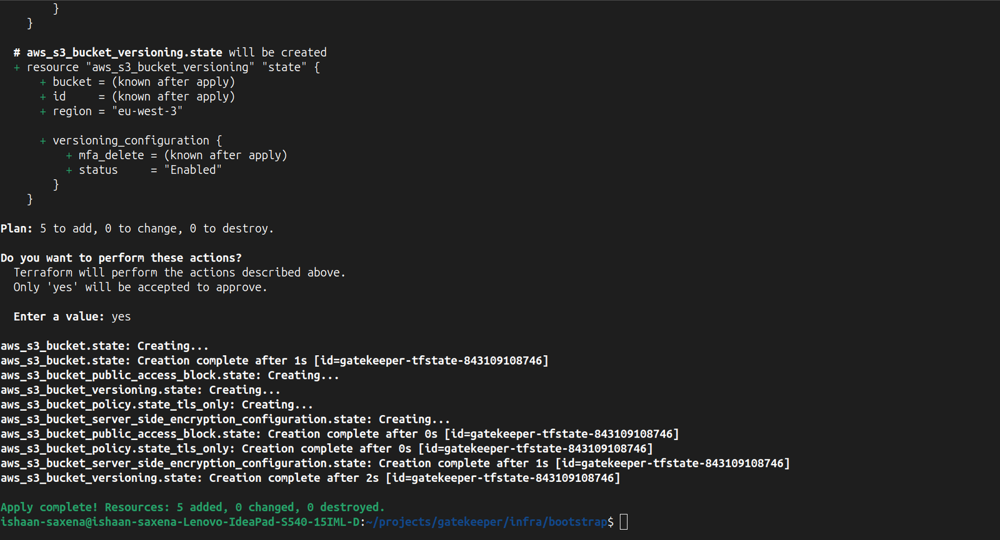
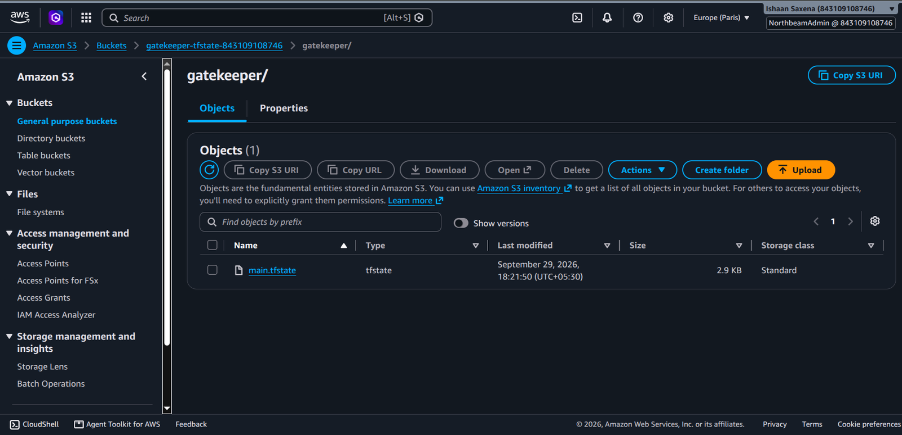
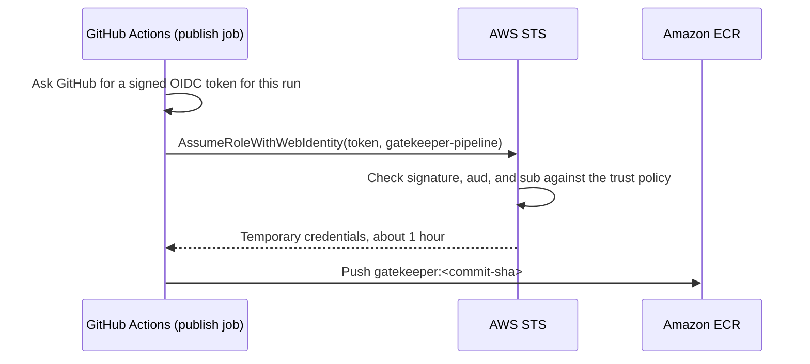
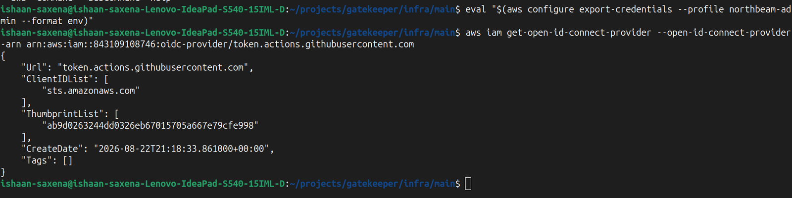
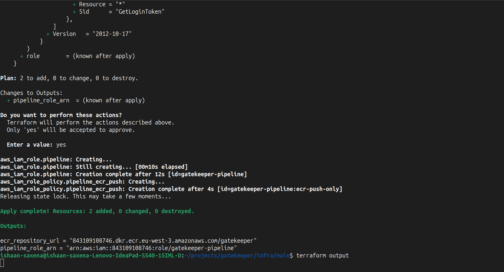
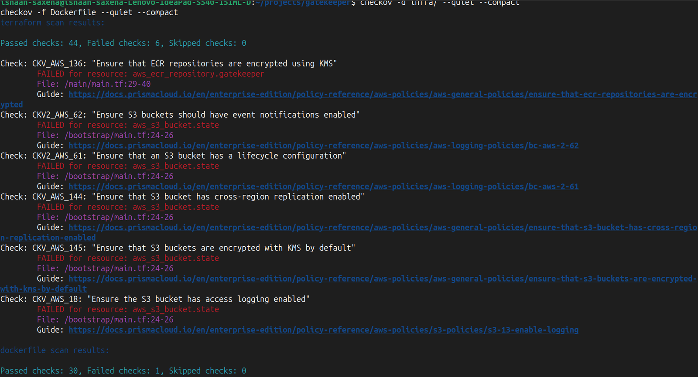
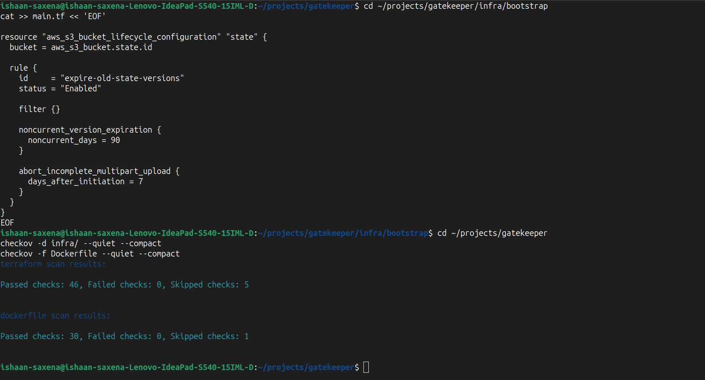

# Infrastructure (Terraform)

The pipeline needs three things in AWS: somewhere to store Terraform's state, a registry to push images to, and a way to log in without a stored key. All three are Terraform in `infra/`, in `eu-west-3` (Paris), with the region set once in the provider block so nothing can drift into another region.



Every resource gets `Project`, `Owner` and `Environment` tags automatically through `default_tags`.

## Logging in from the laptop

My IAM user has no permissions of its own. It can only assume an admin role, and the role's trust policy requires MFA (`aws:MultiFactorAuthPresent`). The CLI profile sets `mfa_serial` so it asks for a code. Terraform cannot stop and ask for an MFA code, so I let the CLI do the MFA once and export the temporary credentials into the shell:

```bash
eval "$(aws configure export-credentials --profile northbeam-admin --format env)"
```

The credentials live only in that terminal and expire after about an hour.

## The state bucket (`infra/bootstrap`)

Terraform state is Terraform's record of what it has built, with real IDs and ARNs. It can also hold secrets in plain text. So it needs protecting, and it cannot sit in git.

The bucket has to exist before any project can keep state in it, so a tiny bootstrap project creates it with local state, once. The local state file is kept out of git by `.gitignore` (`*.tfstate`, `.terraform/`). Before the first commit I checked that git could not see any state file.

Bucket `gatekeeper-tfstate-<account-id>`:

| Setting | What it stops |
|---|---|
| Versioning | A corrupted or overwritten state file with no way back |
| Encryption at rest (AES256) | Someone reading the raw files |
| Block Public Access, all four settings | The bucket ever being exposed to the internet |
| Bucket policy denying `aws:SecureTransport = false` | Any request over plain HTTP |
| Lifecycle rule (added after Checkov, see below) | Old state versions piling up forever |



## Remote state with locking (`infra/main`)

`infra/main` keeps its state in that bucket under `gatekeeper/main.tfstate`, with `use_lockfile = true`. While Terraform runs, a small `.tflock` file sits next to the state, so two `apply` runs at the same time cannot overwrite each other. The second one waits. This is S3 native locking; the older DynamoDB lock table is deprecated in Terraform's S3 backend.



## The registry (ECR)

| Setting | Why |
|---|---|
| `image_tag_mutability = "IMMUTABLE"` | A tag can never be moved to a different image. Pushing the same tag twice fails, so the pipeline tags every image with its commit SHA. |
| Scan on push | ECR's own basic scan of every image that arrives |
| Lifecycle policy: keep the last 5 images | Old images do not pile up and cost money |

## Keyless access for the pipeline (OIDC)

The pipeline must push to ECR. The old way is an access key saved in GitHub's secrets: a permanent password sitting in someone else's system. Instead:



Three pieces:

1. **OIDC provider**: tells AWS to trust tokens signed by GitHub.
2. **Role `gatekeeper-pipeline`** with a trust policy that checks:
   * `aud` is `sts.amazonaws.com`
   * `sub` is exactly this repository's `main` branch
3. **Permissions**: the five ECR actions needed to upload an image, on this one repository only, plus `ecr:GetAuthorizationToken` on `*` (AWS does not allow limiting the login action to one repository).

The `sub` line is the important one. The provider trusts **all** of GitHub, and every GitHub token has the same `aud`. Without `sub`, any repository on GitHub could assume this role.

**The account already had a GitHub OIDC provider.** An AWS account can only have one per URL, and mine was created earlier for another project. `terraform plan` did not warn about this, because plan only compares my code with my state file. The `apply` would have failed halfway with `EntityAlreadyExists`. I checked before applying:



Its client ID list already had `sts.amazonaws.com`, so I switched the provider from a `resource` to a `data` lookup. A lookup uses the provider without owning it, so a `terraform destroy` here can never delete something another project depends on.



**The `sub` format was not what I expected.** The first real publish was refused. GitHub sends this repository's subject with numeric IDs in it, and the fix was in Terraform. The full story is in [Pipeline](pipeline.md#the-first-publish-was-refused).

## Checkov on the Terraform

The first scan: 44 passed, 6 failed.



A finding is a question, not an order. My rule: fix it when it is cheap and solves a real problem in this setup; skip it when it needs extra paid resources or solves a problem I do not have, and write the reason next to the code.

| Check | In plain words | Decision | Reason |
|---|---|---|---|
| CKV2_AWS_61 | Lifecycle rule on the bucket | **Fixed** | I turned versioning on, so every `apply` keeps an old copy of the state forever, and old copies can hold old secrets. A free rule now deletes versions older than 90 days and cleans up failed uploads after 7. |
| CKV_AWS_145 | Encrypt the bucket with my own KMS key | Skipped | Already encrypted with AES256. A customer managed key adds about 1 EUR a month and a key policy to maintain. |
| CKV_AWS_136 | Same, for ECR | Skipped | Same reason |
| CKV_AWS_144 | Copy the bucket to a second region | Skipped | Versioning already gives rollback. Replication means a second bucket and more cost. |
| CKV_AWS_18 | Access logging on the bucket | Skipped | Single user. The log bucket would need its own hardening. |
| CKV2_AWS_62 | Event notifications on the bucket | Skipped | Nothing would listen to them |

Skips are written as `#checkov:skip=<ID>:<reason>` inside the resource, so the reason travels with the code and shows up in every scan. After the fix and the skips: 46 passed, 0 failed, 5 skipped.



In a regulated company, some of these skips (logging, replication) could be mandatory. The decision depends on who is asking.

## Reading a plan

Before every `apply`, I read the plan line by line:

| Symbol | Meaning |
|---|---|
| `+` | Create |
| `~` | Change in place |
| `-/+` | Destroy, then create a new one. Renaming the ECR repository does this: the new repository starts empty and gets a new ARN, so the pipeline role's policy points at nothing. With images inside, AWS refuses the delete unless `force_delete` is set. |
| `-` | Destroy |
