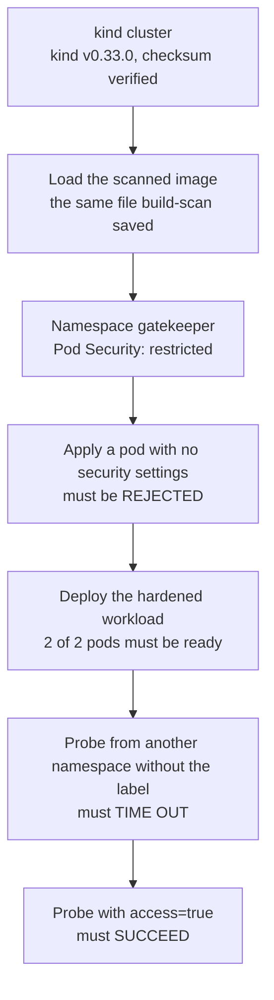
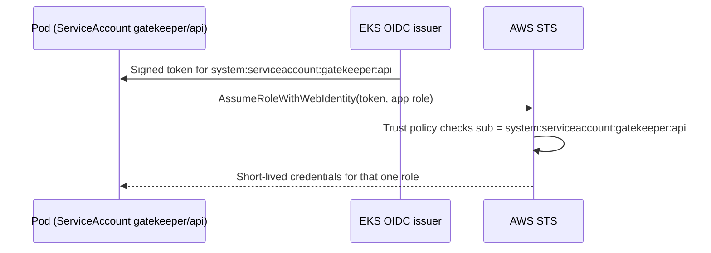

# Kubernetes

The manifests in [`k8s/`](../k8s) run the API under the strictest built-in Pod Security profile and restrict who can talk to it. They are not only written: the pipeline's `kubernetes` job creates a [kind](https://kind.sigs.k8s.io/) cluster on every run, deploys the image that was just scanned, and tests that the controls actually hold.



| File | What it holds |
|---|---|
| `namespace.yaml` | Namespace `gatekeeper` with Pod Security `restricted` enforced, warned and audited |
| `serviceaccount.yaml` | ServiceAccount `api` with no token mounted |
| `deployment.yaml` | 2 replicas of the API, hardened |
| `service.yaml` | ClusterIP service on port 8080 |
| `networkpolicy.yaml` | Default deny all ingress, then one allow rule |
| `probe-namespace.yaml` | A client namespace used to test the NetworkPolicy |
| `tests/restricted-violation.yaml` | A pod that must be refused |

## Pod Security `restricted`

Every object passes an admission check at the API server before it exists. Pod Security Admission is the built-in one, with three levels: `privileged`, `baseline` and `restricted`. The namespace label sets it to `restricted`.

The pipeline applies a pod with no security settings at all (server side dry run) and expects a refusal. The real answer from the cluster:

```
pods "no-security-context" is forbidden: violates PodSecurity "restricted:latest":
  allowPrivilegeEscalation != false (container "api" must set securityContext.allowPrivilegeEscalation=false),
  unrestricted capabilities (container "api" must set securityContext.capabilities.drop=["ALL"]),
  runAsNonRoot != true (pod or container "api" must set securityContext.runAsNonRoot=true),
  seccompProfile (pod or container "api" must set securityContext.seccompProfile.type to "RuntimeDefault" or "Localhost")
```

That list is the checklist the real deployment has to meet.

## The hardened deployment

| Setting | Attack it blocks |
|---|---|
| `runAsNonRoot: true`, `runAsUser: 10001`, `runAsGroup: 10001` | If the app is taken over, the attacker is not root, so escaping the container is much harder. The image's user is numeric, which is what lets Kubernetes verify it. |
| `allowPrivilegeEscalation: false` | A process cannot gain more privileges than it started with, for example through setuid programs |
| `capabilities: drop: ["ALL"]` | Removes special kernel powers such as raw sockets, which are used for packet spoofing |
| `readOnlyRootFilesystem: true` | An attacker cannot download tools or plant files. Only `/tmp` is writable, through a small `emptyDir`, because gunicorn needs it for worker heartbeat files. |
| `seccompProfile: RuntimeDefault` | Blocks dangerous, rarely needed system calls |
| `automountServiceAccountToken: false` | A compromised pod has no token to talk to the Kubernetes API |
| CPU and memory requests and limits | One pod cannot starve the node |
| Readiness and liveness probes on `/health` | Traffic only goes to pods that answer, and stuck pods are restarted |

In the pipeline the deployment comes up with **2 of 2 pods ready** under `restricted`.

Checkov scans these manifests too: 90 checks pass, and two are skipped with a reason in the Deployment's annotations. CKV_K8S_43 (image by digest) and CKV_K8S_15 (pull policy `Always`) do not fit a cluster where the image is loaded directly and never pulled from a registry. The registry copy is addressed by its commit SHA tag in an immutable ECR repository.

## NetworkPolicy: tested, not assumed

By default every pod can talk to every other pod in the cluster, so one compromised pod can reach all of them. A NetworkPolicy is a firewall rule chosen by labels, but it only works if the cluster's network plugin enforces it. Older kind versions accepted policies and silently ignored them. "Policy applied but not enforced" is a real audit finding, which is why the pipeline tests both directions.

Two policies in the `gatekeeper` namespace:

1. `default-deny-ingress`: nothing can connect to anything.
2. `allow-api-from-labelled-clients`: port 8080 on the API pods, only from pods labelled `access: "true"` in the `probe` namespace.

The `probe` namespace has no Pod Security label on purpose. A test pod inside the `restricted` namespace would be refused for a different reason, and the test would prove nothing.

The probe pods run the same scanned image and use Python's `urllib` to call `http://gatekeeper.gatekeeper.svc:8080/health` with a 5 second timeout, so no extra third party image enters the test cluster. Result on every run:

| Probe pod | Label | Expected | Result |
|---|---|---|---|
| `no-label` | none | Blocked | `Failed, no answer: <urlopen error timed out>` |
| `with-label` | `access=true` | Allowed | `Succeeded, {"status":"ok"}` |

## How a pod would get AWS access (IRSA)

This app needs no AWS access at runtime, and the cluster is local. The design still matters, because it is where most cloud breaches through Kubernetes happen.

**The bad pattern:** give the node's EC2 instance role broad permissions. Every pod on that node can then use them. A bug that lets an attacker make the server call the instance metadata service (SSRF) hands them those credentials. That is how the Capital One breach worked.

**IRSA (IAM Roles for Service Accounts):**



It is the same `AssumeRoleWithWebIdentity` flow as this project's GitHub pipeline role, with a different issuer and a different `sub`. Only pods using that exact ServiceAccount get that role, and nothing else on the node does. AWS's newer EKS Pod Identity gets the same result with less OIDC setup.

The app also refuses to call `169.254.169.254` through `/ping`, because it only accepts public addresses.
