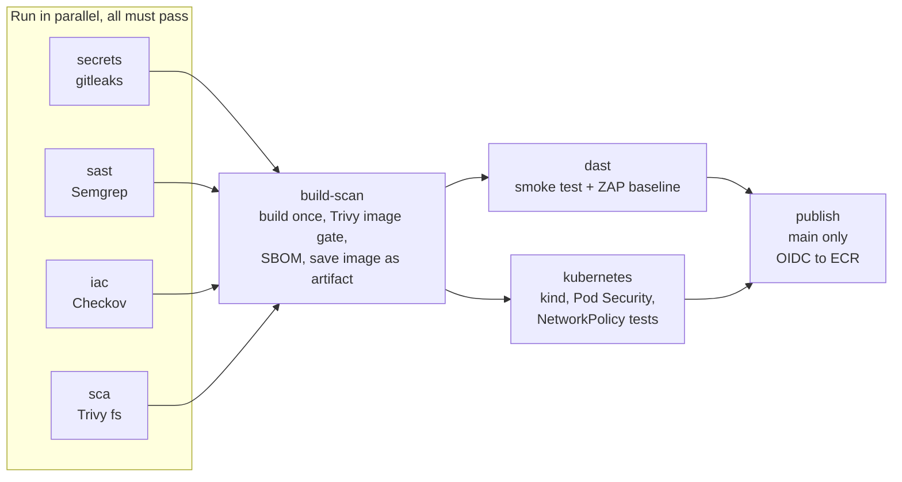
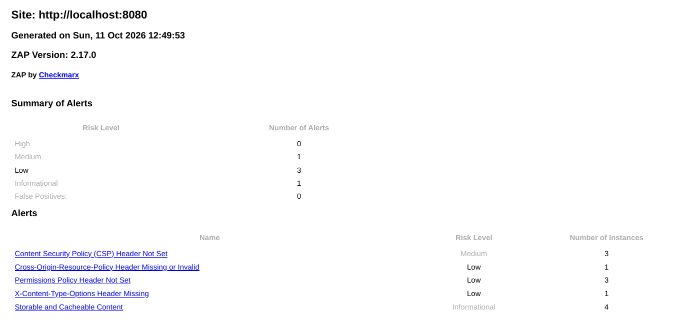
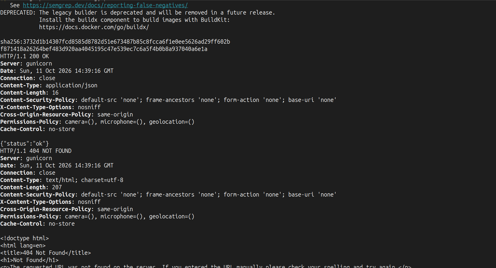
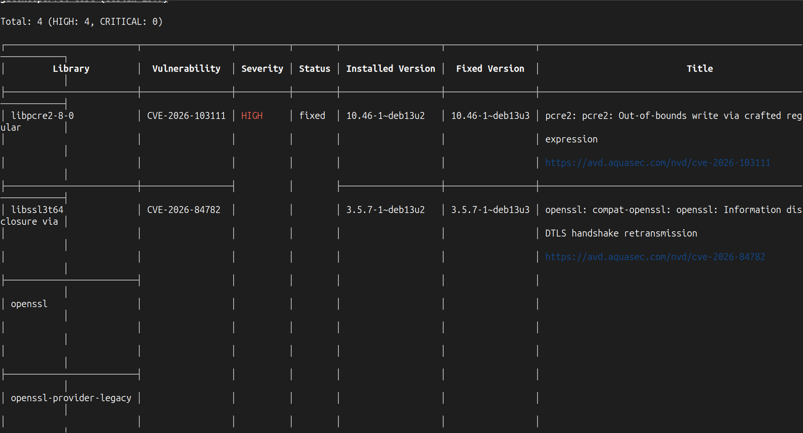

# Pipeline

One GitHub Actions workflow, [`.github/workflows/gatekeeper.yml`](../.github/workflows/gatekeeper.yml), runs on every pull request and every push to `main`. Nothing reaches ECR unless every gate passes, and the pipeline itself is hardened, because it is now the most privileged thing in the project.



## The gates

| Job | Tool | Question it answers | Fails when |
|---|---|---|---|
| `secrets` | gitleaks | Has a credential ever been committed, in any commit? | Any finding |
| `sast` | Semgrep (`p/python`, `p/flask`) | Is my own code written dangerously? | Any finding |
| `iac` | Checkov | Is a config unsafe? (Terraform, Dockerfile, Kubernetes, workflows) | A failed check without a written skip, or no checks run on the workflow file |
| `sca` | Trivy fs | Do my dependencies have known CVEs? | HIGH or CRITICAL with a fix available |
| `build-scan` | Trivy image | Does the built image (OS packages and libraries) have known CVEs? | HIGH or CRITICAL with a fix available |
| `dast` | curl + OWASP ZAP baseline | Does the running app behave, and does it send the right security headers? | A smoke check fails, or any ZAP alert not accepted in `.zap/rules.tsv` |
| `kubernetes` | kind + kubectl | Does it run under Pod Security `restricted`, and does the NetworkPolicy really block and allow? | Any of those tests fails |
| `publish` | AWS OIDC + ECR | | Runs only on a push to `main`, after everything above passed |

Three ideas shape the order:

* **Fail fast.** The four cheap checks run first and in parallel. A leaked secret fails in seconds, not after a five minute build.
* **Build once, promote the same artifact.** The image is built once, scanned, and saved as a file (`docker save`). DAST, the Kubernetes tests and the push all load that exact file. Rebuilding for the push would produce a different, unscanned image.
* **Traceability.** The image is tagged with the commit SHA, so every image in ECR maps to one commit.

## DAST

The `dast` job loads the saved image, starts it, and runs two checks against it.

**Smoke test.** `/health` must return 200; `/ping` must return 400 for a non-IP, for `127.0.0.1` and for `169.254.169.254`, and 200 for a public IP; and five security headers must be present.

**ZAP baseline.** The baseline scan crawls the running app and reads its responses. It does not send attack payloads, so it cannot find something like command injection. That is what Semgrep is for. What it finds is what only exists once the app is answering requests, like headers.

The first report on the app had 1 Medium, 3 Low and 1 Informational alert, all about missing headers:



All three CSP alerts were on 404 pages that ZAP requests by itself (`/`, `/robots.txt`, `/sitemap.xml`), so the fix had to cover error pages too. I added an `after_request` hook in Flask that puts five headers on every response, including errors:

| Header | Value | Meaning |
|---|---|---|
| `Content-Security-Policy` | `default-src 'none'; frame-ancestors 'none'; form-action 'none'; base-uri 'none'` | Load nothing from anywhere. An API returns data, not pages. |
| `X-Content-Type-Options` | `nosniff` | Do not guess a file's type |
| `Cross-Origin-Resource-Policy` | `same-origin` | Other sites cannot read these responses |
| `Permissions-Policy` | `camera=(), microphone=(), geolocation=()` | No camera, microphone or location |
| `Cache-Control` | `no-store` | Never keep a copy |



After the fix, ZAP passed 66 rules and raised one Informational alert: **Non-Storable Content**, which exists only because of `Cache-Control: no-store`. I accepted it in `.zap/rules.tsv` as `INFO` with the reason written next to it, and removed `-I` (report only) from the scan. Now any other alert fails the build.

## Hardening the pipeline itself

A CI system holds the keys to production. Attacking the pipeline is often easier than attacking the app.

In March 2026, the Trivy scanner's own GitHub Action was turned into a credential stealer. Attackers used access left over from an earlier incident to publish a malicious release and move the Action's version tags to it. Every pipeline that used `aquasecurity/trivy-action@<tag>` ran the malicious code with access to its secrets on its next run, without changing a line (CVE-2026-33634, advisory GHSA-69fq-xp46-6x23). The controls below are my answer to that kind of attack.

| Control | Where | What it stops |
|---|---|---|
| Every action pinned to a full commit SHA, version in a comment | `uses: actions/checkout@3d3c42e... # v7.0.1` | A moved tag pulling in different code. A commit SHA cannot be moved. |
| Tool downloads checked against a SHA-256 written in the workflow | gitleaks, Trivy, kind | A swapped release file. The step stops if the fingerprint differs. |
| Container images pinned by digest | Base image, ZAP image | A re-pointed image tag |
| `permissions: contents: read` at the top | Every job | A compromised scanner cannot write to the repo |
| `id-token: write` only on `publish` | One job | A compromised scanner cannot get AWS credentials. Only the job that pushes can ask for a token. |
| `publish` runs only on a push to `main`, and the role trusts only `main` | Workflow `if` + IAM trust policy | Two independent locks. A pull request cannot publish even if one of them is wrong. |
| `persist-credentials: false` on checkout | Every checkout | The repo token is not left in the git config for later steps |
| No `pull_request_target` trigger | Whole workflow | That trigger runs with secrets on code from strangers; the earlier Trivy incident was traced to one |
| gitleaks runs with `--redact` | `secrets` | The repo is public, so the logs are public. A finding is not republished in the log. |
| Dependabot for actions, pip and the base image | `.github/dependabot.yml` | Pins that never move go stale. Flask and Werkzeug updates are grouped so they always move together. |
| Ruleset on `main`: pull request required, all gates required, no force push, no deletion | Repository settings | Without it, a red pipeline is only a suggestion |

## Findings from running it

### A pinned base image ages

The base image is pinned by digest, which stops anyone swapping it. It also freezes it. Two weeks after it was pinned, the image gate found 4 HIGH findings with fixes available, from 2 Debian bugs (`libpcre2-8-0` and the `openssl` family) that had been patched since:



I moved the pin to the newest `python:3.13-slim` digest, and the gate passed again. Dependabot now proposes that refresh every week.

### The hardened image broke a feature

The first run of the smoke test ([run #5](https://github.com/Ishaan-03/gatekeeper/actions/runs/38308334850)) showed `/ping` returning **500 for every host**. The slim image has no `ping` program. Even with one, ping needs the `NET_RAW` capability, which the Kubernetes deployment drops.

I replaced the subprocess call with a TCP connection to port 443 using Python's `socket` library:

* No subprocess at all, so there is no command left to inject into
* Only public addresses are accepted (`ipaddress.is_global`), so loopback, private ranges and the cloud metadata address `169.254.169.254` are refused. That turns a would-be SSRF endpoint into a narrow check.

The next run passed every smoke check.

### Checkov skipped my workflow file without saying so

I had added a `concurrency` block whose `cancel-in-progress` value was an expression. GitHub accepts that. Checkov 3.3.19 does not, and instead of reporting an error it scanned **0 resources** in the file and still reported success. Without the block, the same file ran 204 checks.

I removed the block, and added a step to the `iac` job that fails if Checkov runs no checks on the workflow file. A scanner that silently skips a file is worse than one that crashes.

### The first publish was refused

The first push to `main` passed every gate, then `publish` failed with:

```
Could not assume role with OIDC: Not authorized to perform sts:AssumeRoleWithWebIdentity
```

That message almost always means the token's `sub` does not match the trust policy. I added a step that runs only when the AWS login fails and prints the decoded claims, never the signed token ([run #10](https://github.com/Ishaan-03/gatekeeper/actions/runs/38310610974)):

```json
{"sub":"repo:Ishaan-03@166810647/gatekeeper@1414191999:ref:refs/heads/main",
 "aud":"sts.amazonaws.com","repository":"Ishaan-03/gatekeeper","ref":"refs/heads/main","event_name":"push"}
```

GitHub puts the numeric owner and repository IDs in the subject for this repository. The trust policy expected `repo:Ishaan-03/gatekeeper:ref:refs/heads/main`. I changed the Terraform to build the subject from the names and the IDs. IDs are never reused, so if this repository were deleted and someone created a new one with the same name, it could not assume the role.

## Proving the gate works

PROOF_PLACEHOLDER

## Publishing without a key

PUBLISH_PLACEHOLDER
