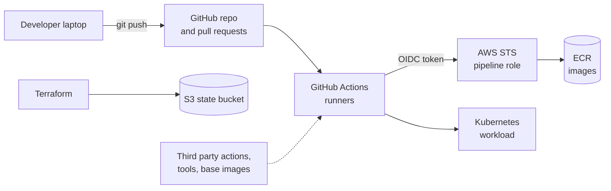

# Threat model

What could go wrong between a developer's keyboard and a running container, and what in this repository stops it. Every control listed here exists in the repo and runs in the pipeline unless the row says otherwise.

## Assets

| Asset | Why it matters |
|---|---|
| Source code and git history | Anything committed is public and permanent |
| The container image | What actually runs |
| The pipeline role (`gatekeeper-pipeline`) | Can write images to the registry production would pull from |
| Terraform state | Holds real IDs, ARNs and possibly secrets in plain text |
| The running workload | Serves requests and sits on a cluster network with other pods |

## Threats and controls

| # | Threat | Example | Control in this repo | Where |
|---|---|---|---|---|
| 1 | Leaked credential | An API key committed in a Dockerfile | gitleaks before every commit, and again over the full history in CI with `--redact`. A leak that already happened is fixed by revoking the key, not by deleting the line. | `.pre-commit-config.yaml`, `secrets` job |
| 2 | Vulnerable dependency | `werkzeug 2.2.2` with CVE-2024-34069 | Trivy fs gate on HIGH and CRITICAL with a fix; exact pins; Dependabot weekly | `sca` job, `app/requirements.txt`, `dependabot.yml` |
| 3 | Vulnerable OS package in the image | `openssl` fix published after the base image was pinned | Slim base, Trivy image gate, digest pin refreshed by Dependabot | `Dockerfile`, `build-scan` job |
| 4 | Injection in app code | `subprocess.run(f"ping {host}", shell=True)` | Semgrep gate; input validated as an IP; no subprocess at all in the final code | `sast` job, `app/main.py` |
| 5 | Server side request forgery | `/ping?host=169.254.169.254` to reach cloud metadata | `/ping` only accepts public (`is_global`) addresses, tested in the smoke test | `app/main.py`, `dast` job |
| 6 | Missing browser protections | No CSP or `nosniff` | Headers on every response, ZAP baseline as a gate | `app/main.py`, `dast` job |
| 7 | Compromised third party action or tool | A moved version tag, like the March 2026 Trivy Action attack | Actions pinned to commit SHAs; tool downloads checked against a SHA-256; images pinned by digest | `gatekeeper.yml` |
| 8 | Compromised job steals cloud access | A poisoned scanner reads the AWS credentials | Read-only token by default; only `publish` can request an OIDC token; no AWS key stored anywhere | `gatekeeper.yml` permissions |
| 9 | Over-privileged pipeline role | The role can delete repos or read other services | Trust: one repo (by name and numeric ID), `main` only. Permissions: push to one ECR repository, plus the login call. | `infra/main/iam.tf` |
| 10 | A different repository assumes the role | Someone recreates a deleted repo with the same name | The trust policy's `sub` includes the owner and repository IDs, which are never reused | `infra/main/iam.tf` |
| 11 | Untrusted code runs with secrets | A fork's pull request triggers a privileged workflow | No `pull_request_target`; `publish` never runs on pull requests, and the role does not trust pull request tokens | `gatekeeper.yml`, `iam.tf` |
| 12 | Gates bypassed | A red pipeline merged anyway, or history rewritten | Ruleset on `main`: pull request required, every gate required, no force push, no deletion | Repository ruleset |
| 13 | Image swapped after scanning | A different image pushed than the one tested | Built once, saved as a file, the same file loaded for DAST, Kubernetes and the push; tagged with the commit SHA; ECR tags immutable | `build-scan`, `publish`, `infra/main/ecr.tf` |
| 14 | Public or stolen state file | State committed to git or bucket made public | `.gitignore` for state; bucket with Block Public Access, encryption, TLS only, versioning, locking | `.gitignore`, `infra/bootstrap` |
| 15 | Misconfigured infrastructure | An unencrypted bucket or a root container | Checkov on Terraform, Dockerfile, Kubernetes and workflows; every skip has a written reason | `iac` job |
| 16 | A scanner silently skipping a file | A schema problem makes Checkov scan 0 workflow resources | The `iac` job fails if no checks ran on the workflow file | `iac` job |
| 17 | Container breakout or privilege escalation | Root process with all capabilities | Non-root numeric user, no privilege escalation, all capabilities dropped, read-only root filesystem, seccomp, enforced by Pod Security `restricted` | `k8s/`, `kubernetes` job |
| 18 | Lateral movement between pods | A compromised pod reaches the API | Default deny ingress; only labelled pods in one namespace may connect; tested in both directions | `k8s/networkpolicy.yaml`, `kubernetes` job |
| 19 | Pod abuses the Kubernetes API | A stolen service account token | No token mounted; dedicated service account | `k8s/deployment.yaml` |

## Residual risks

These are accepted, with the reason:

| Risk | Why it is accepted here |
|---|---|
| HIGH CVEs in Debian packages with no fix published | Nothing to upgrade to yet. The gate blocks them the moment a fix exists. Most need local mount or login tools this app never uses. |
| Outbound traffic from the API pods is not restricted | `/ping` needs outbound access to public addresses by design, and the app refuses private and metadata addresses itself |
| ECR and the state bucket use AWS managed encryption keys, not customer managed KMS keys | Single user lab; the extra key adds cost and a key policy to maintain. Documented as Checkov skips. |
| `ecr:GetAuthorizationToken` is allowed on `*` | AWS does not support limiting this action to one repository. It only returns a login token; what the token can do is limited by the other statement. |
| The role ARN and account ID are visible in the public repo | They are identifiers, not credentials. Assuming the role needs a GitHub token that matches the trust policy. |
| The Kubernetes cluster is local (kind), not EKS | The controls are the same API objects. See the decision log. |
